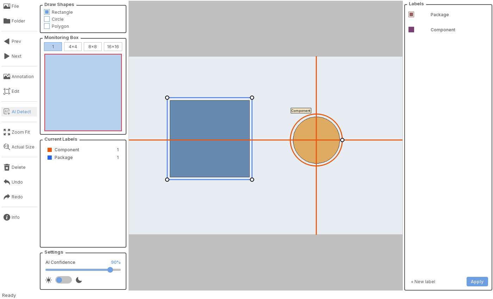

# LZR Labeler

A Python/PySide6 desktop application for annotating images with rectangles,
circles, and polygons. Originally developed around PCB inspection, this version
starts with a general-purpose label list and retains PCB categories as an optional preset.



## Features

- Image and folder navigation, zoom, shape editing, and undo/redo controls.
- Custom labels and colors; optional PCB inspection preset.
- JSON annotations in original image coordinates.
- Atomic annotation saves, validation, and protection against overwriting unreadable files.
- Light and dark themes.
- Optional integration with existing PyTorch detector checkpoints; inference runs in a worker thread.

## Install and run

Python 3.11 or newer is required. From the repository folder on Windows:

```powershell
python -m venv .venv
.\.venv\Scripts\python.exe -m pip install -e ".[dev]"
.\.venv\Scripts\python.exe -m lzr_labeler
```

With the environment activated, `lzr-labeler` also launches the application.
For the PCB categories, add `--preset pcb`. General-purpose mode is the default.
Open an image or folder, add a label in the Labels panel, select a drawing tool,
and annotate. Changes are saved automatically. Assign labels before navigating away.

Custom labels are stored in the OS user configuration directory under `lzr-labeler`.
For an isolated workspace, set `LZR_LABELER_CONFIG_DIR` to a writable directory.
Existing custom label files can be copied there manually; this version does not
change the configuration of the original application.

## Annotation files and compatibility

New annotations for `photo.png` are saved to `Labels/photo.png.json`. Keeping the
image extension distinguishes `photo.png` from `photo.jpg` in the same folder.
The JSON contains `schema_version`, `image`, and `annotations`. Rectangles use
two corners, circles use a center and diameter, and polygons use point lists.

Legacy `Labels/photo.json` files can be read when there is no same-stem ambiguity.
The original file is retained when a new-format file is saved. Empty annotations
are saved explicitly, so deleting every shape does not restore the legacy shapes.
If both image extensions exist, manually identify the correct legacy file before
migrating it. Never guess which image it belongs to.

A failed save prevents navigation or closing. An unreadable annotation file makes
that image read-only; repair or move the file and reopen the image. Other images
remain available. The format is LZR-specific, not LabelMe/COCO/YOLO format.

## Optional AI integration

```powershell
.\.venv\Scripts\python.exe -m pip install -e ".[ai]"
.\.venv\Scripts\python.exe -m lzr_labeler --models-dir C:\path\to\models
```

The directory must contain exactly one compatible `.pth` checkpoint and
`meta_info.json` matching the existing model loader. No weights or research data
are distributed here. Manual annotation does not require PyTorch. Model loading
and inference run off the GUI thread; results for a different image are discarded.
Closing waits for the user to finish an active AI operation rather than killing it.

This is an integration with the existing detector pipeline, not a universal
pretrained detection model. Accuracy and real-model inference have not been
benchmarked in this upgrade. Use only model files from a trusted source.

## Development

```powershell
.\.venv\Scripts\python.exe -m pytest -q
.\.venv\Scripts\python.exe -m build
```

Tests cover annotation round trips, malformed data, save failures, legacy files,
presets, GUI save guards, and stale AI results. GitHub Actions is configured to
test Python 3.11/3.13 on Windows and Linux and upload wheel/source build artifacts.
The workflow will first run when this project is pushed to GitHub; no passing CI
badge or remote execution is claimed here.

The source package contains `core` (storage, shapes, labels, model handling),
`ui` (window and annotation canvas), and `theme` (palette and custom widget styles).
Tests live outside the application package. See [upgrade notes](docs/upgrade-notes.md).

## Release status

Version 0.2.0 is a local upgrade candidate. Windows is the locally tested platform;
Linux execution still needs verification by CI. Automated packaging is included;
publishing releases and building standalone executables are not yet configured.
Manual interaction testing on representative real images is still required.

The copied source, branding, fonts, icons, and documentation retain their existing
provenance. No new open-source license is asserted. Confirm redistribution rights
and add appropriate license/attribution files before making the repository public.

